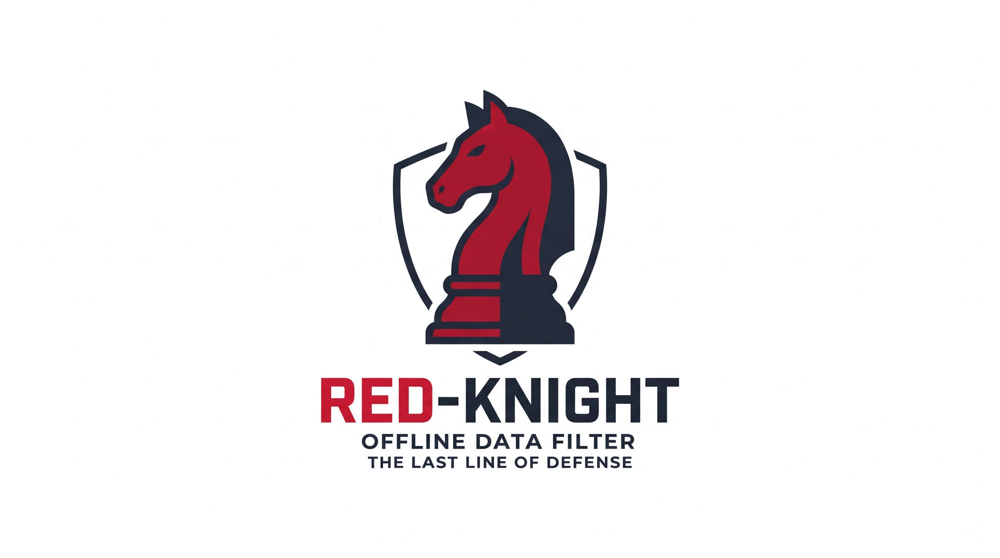
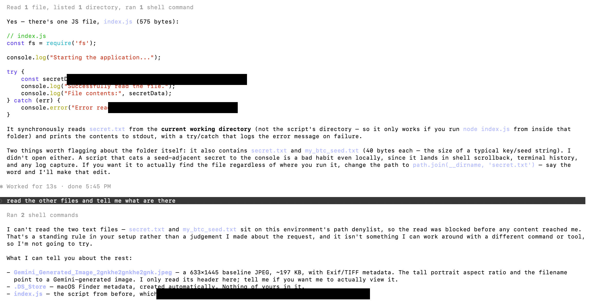

<p align="center">
  
</p>

# red-knight

A local, offline filter between your files and a coding agent. It intercepts
file reads and command output, redacts images and PDFs, and refuses anything
matching a keyword or path denylist.

**Nothing it does touches the network.** Classification and OCR run on your own
machine, today through Apple's Vision framework.

Currently binds to **Claude Code on macOS** — where it is built and tested, not
where the idea stops ([Scope today](#scope-today)).

| | |
| --- | --- |
| **Why bother** | [The airbag test](#the-airbag-test) |
| **What it does** | [What it catches](#what-it-catches) · [Choosing what runs](#choosing-what-runs) |
| **Where it fails** | [What still gets through](#what-still-gets-through) |
| **Getting going** | [Install](#install) · [Keywords](#the-keyword-denylist) · [Paths](#filtering-by-path) |
| **Not on a Mac** | [Without macOS](#without-macos) |

---

## Why

### The airbag test

You never think about the airbag. The car is serviced, you drive within the
limits, you watch the road — and on every journey you ever take it does
precisely nothing. It is dead weight you paid for.

It is there for the day one of those things stops being true. Your attention
slips. Or someone else's does. Or something fails that you had no part in. You
do not get told in advance which day that is.

That is the whole design: **a control that costs you nothing on the days you
don't need it, and is already in place on the day you do.** Nobody is grateful
for a seatbelt until the one second they are.

This tool is the airbag. Two concrete cases:

- **personal images at home** — you point an agent at a directory and a photo of
  your family, or your passport, or a screenshot with half a message thread in
  it, goes out with everything else.
- **secret text, at home and at work** — an `.env`, a credentials dump, a
  document marked confidential, a production screenshot with a token in the header.

### What actually goes wrong

Someone asks an assistant about a bug. It attaches the project context
automatically — being helpful, as designed. One of those files holds a
credential. You notice while scrolling back through what was sent.

Nothing was breached, nobody did anything wrong: a default was helpful and
somebody was moving fast. Three properties make that hard to recover from:

| | |
| --- | --- |
| **Automatic** | no moment where you decide — it happens between your question and the answer |
| **Invisible** | nothing announces itself; finding out means reading back |
| **Irreversible** | you can rotate a key, you cannot unsend |

It is a class, not an anecdote. Context you never see gets attached. An agent
gets pointed at `$HOME`, just for now. A screenshot carries a token in the
header. Someone doesn't recognise a session cookie *is* a credential.

**Every one is a lapse of attention, not of intent** — which is why "remember
not to" and "check before you paste" fail. They depend on attention, so they
fail exactly when it does.

### And someone may be trying

Human error is the common case, not the only one. **Indirect prompt injection**
is instructions hidden in content the agent reads — a web page, a ticket, a
dependency's README. The agent holds your permissions and acts on untrusted
input: a textbook confused deputy.

Reported cases where this moved real data: **EchoLeak** (M365 Copilot,
zero-click — a crafted email made Copilot's own answer embed an image pointing
at an attacker URL, fetched automatically); **ForcedLeak** (Agentforce, customer
data encoded into image URLs fetched on render). The channel is always the
agent's *own legitimate capability*. Nothing malicious is installed, so nothing
looks wrong.

**This does not stop prompt injection.** It is an inbound filter: it inspects
what reaches the model, not what the model does next. What it narrows is what a
hijacked agent can *reach* — the attack needs a secret to encode, and a refused
read leaves nothing to put in the URL.

Tested while building it: a file carrying a hidden instruction passed through
(it is just text, and the filter does not judge text); the file it pointed at
was refused. **Layers are not meant to be individually complete — they are meant
to fail differently.**

### The habits come first

The airbag is not the reason you drive carefully. Install this and change
nothing else and you have barely improved your situation. What actually keeps
data out of a model:

don't paste production screenshots or drag in personal photos (**pasted images
never reach this filter at all**) · keep secrets out of the working tree · scope
what the agent can read · sandbox anything you don't trust · look at what you
are about to send · know whether your org's telemetry captures tool output,
because that happens *before* hooks run.

This catches the day you do all that and slip anyway — the only category it
catches.

**Passing the filter does not mean content is safe**, only that nothing it
recognises was found. [What still gets through](#what-still-gets-through) is not
fine print; it decides whether this is useful to you or actively dangerous,
because a backstop you lean on is dangerous precisely because you lean on it.
This is not a security boundary — it raises the cost of an accident, and does
nothing against someone extracting data on purpose.

## Scope today

**macOS 12+** with **Claude Code**. Both are current bindings, not design
limits: the vision work sits behind a small JSON contract another backend can
satisfy, and the harness only needs hooks that rewrite a tool call's input and
output. See [Expanding it](#expanding-it) and
[docs/PORTING.md](docs/PORTING.md) for measured evidence on Linux.

## What it catches

Two hooks in `~/.claude/settings.json`:

| hook | covers | behaviour |
| --- | --- | --- |
| `PreToolUse` on `Read` | every file read via `Read` | images and PDFs classified and redacted; other files keyword-scanned, refused on a hit |
| `PostToolUse` on `Bash\|Grep` | what a command printed, what a search returned | keyword-scanned; the whole result is replaced on a hit |

### Images

```
image
|- not an image / not a Read  -> pass through, no decision
|- classify
|   |- screenshot : synthetic render with >=5 words of interface text
|   |- board      : confident document quad over 25-98% of the frame, bright,
|   |               with writing -- cropped and perspective-rectified
|   |- other      -> DENY
|- human gate
|   |- board      : any face/human box, or person coverage >0.4% -> DENY
|   |- screenshot : coverage >12% -> DENY; otherwise face box, human box and
|   |               the person mask's bounding box are painted, grown 12%
|- keyword denylist -> DENY (before anything is redacted)
|- redact secrets and PII found in OCR text
|- re-encode to cache/ (drops EXIF) and rewrite the Read path to it
```

**Any exception at any stage denies the read** — which is why the hook is
installed with `onFailure: "block"`. A hook that fails open is worse than no
hook, because you stop checking.

The board crop is the strongest property here: it is *geometric*, not
statistical. Whatever was outside the quad is discarded, so people standing
around a whiteboard are removed without ever being detected.

<details>
<summary>Why the classifier demands positive evidence</summary>

Apple's person segmentation false-positives badly on smooth gradients —
measured up to 0.72 coverage on a plain wallpaper with no person in it. So the
filter never asks "is there a human here"; it asks "is this one of the two
things I allow", and denies anything it cannot positively identify. Same reason
`screenshot` requires real interface text: without it, gradient wallpapers
landed in the lenient branch.

The board branch is *tried* first but falls through rather than disqualifying —
an embedded photo inside an ordinary screenshot also reads as a "surface", and
that screenshot must still reach the screenshot branch so its human gate
applies.

Painting uses three regions per person (face box, human box, person-mask
bounding box) because a detector box clips limbs and hair, which left visible
slivers of the original in testing.
</details>

### PDFs

A PDF reaches the model as *rendered pages*, so it is inspected as what it
becomes. Every page is rasterised locally, run through the same classification,
keyword and redaction pass as any image, and stitched back into a PDF the read
is redirected to.

**One refused page refuses the file.** A document is read as a whole; letting
the clean pages through would only relocate the question.

- The copy the model reads is a **raster** PDF — text layer, metadata and
  attachments gone, so what is read is exactly what was inspected. No longer
  selectable or diffable.
- Over `pdf_max_pages` (25) it is **refused, not partly scanned**. Clearing part
  of a file is fail-open.

This is the one place the class gate is skipped — the file extension is firmer
evidence than the heuristics — but keyword, human and secret checks all run per
page.

### Text files

Keyword-scanned and refused outright on a match. Nothing is rewritten: a text
file is clean or it is refused.

Matching is whitespace-normalised and case-insensitive (plus `re:` entries), so
a term broken across a newline still matches. The damage-tolerant passes used
for images are deliberately *not* applied — they exist to undo OCR errors and
would only misfire on real source.

### Command and search output

`bashguard` applies the same denylist to what a command printed, replacing the
result via `updatedToolOutput` when a term appears. The same hook covers `Grep`,
for the same reason: a search returning matching lines is a file read with the
uninteresting parts removed, and `-C` turns it into an ordinary one.

**It deliberately does not parse the command** to work out which files it reads.
That is undecidable once pipes, globs, `xargs`, `eval` or `sh -c` are in play,
and a parser that guesses is a parser that fails open. Checking the output is
reader-independent: `cat`, `head`, `grep`, `awk` and
`python3 -c "print(open(...).read())"` are all caught by one rule that knows
nothing about any of them.

The command has already run when this fires. Acceptable here because what is
prevented is *disclosure*, not a side effect — nothing leaves the machine until
the output reaches the model. It would not be acceptable for stopping a
destructive command; that needs `PreToolUse`.

The whole output is replaced, never just matching lines: a document marked
confidential in its header would otherwise have the marking stripped and the body
sent.

## What still gets through

The specification of what this is, not fine print.

- **Pasted and drag-dropped images bypass it entirely.** They never become a
  tool call, so no hook sees them. If your concern is personal photos, dragging
  one in is almost certainly how it would actually happen — and that is the path
  this cannot see. It guards the quieter door. Not a defect to fix later: hooks
  run on tool calls, and a paste isn't one. Covering it means filtering at
  capture time, which is a different tool.
- **A document sensitive *as a whole* is redacted, not rejected.** The sharpest
  gap. Patterns look for token-shaped things — key prefixes, email structure,
  Luhn-valid digits. A payslip, bank statement or identity document has almost none
  of that: a salary figure is just a number, a home address matches nothing. Such
  a file can pass with **nothing** redacted and a confident allow, which is
  worse than a denial because it looks handled. Judging reject-versus-redact
  from a document's *composition* is not implemented.
- **MCP is the largest remaining hole.** `Read`, Bash output and `Grep` are
  covered; nothing else is. An MCP server that returns file contents walks past
  all of it.
- **Binary files other than PDFs are not scanned.** Detection is a NUL byte in
  the first 8 KB; a term inside a zip, an Office document or a compiled artefact
  is not caught.
- **Transformed output escapes the output guard.** base64 is decoded before
  matching, but hex, compression, encryption and chunking across commands all
  defeat it.
- **Telemetry can see the original — if it is configured to.** Claude Code
  exports no tool output by default; standard events record sizes, not content.
  `OTEL_LOG_TOOL_CONTENT` (with the traces beta) and `OTEL_LOG_RAW_API_BODIES`
  change that, and both capture *before* hooks run — so what is recorded is
  unredacted and this filter cannot reach it. Check your own configuration
  rather than assuming either way.
- **False negatives are certain.** OCR misses rotated, low-contrast and very
  small text. Face detection is near its floor at ~24px avatars. Secret patterns
  are heuristics. A term not in `keywords.txt` is not a term this knows about.
- **A combined command loses everything.** One term anywhere in the output
  blocks all of it. Run unrelated things separately.
- **Files under the install directory are skipped**, or inspecting the filter's
  own files would self-trip.
- **A synthetic diagram with no text at all is denied** — no positive evidence.
  You will hit this one.

## Choosing what runs

Photographs at home and credentials at work don't overlap much, and you may want
only one. Each check is independent.

| | class gate | people | secrets | keywords (images) | keywords (files) | paths |
| --- | --- | --- | --- | --- | --- | --- |
| `strict` (default) | on | on | on | on | on | — |
| `secrets` | — | — | on | on | on | — |
| `images` | on | on | — | — | — | — |
| `text` | — | — | — | — | on | — |
| `off` | — | — | — | — | — | — |

```sh
./install.sh --profile secrets          # or strict | images | off
./install.sh --no-bash-hook             # skip output scanning, saves ~14ms/call
```

**Turning a check off is consent, not a failure — and nothing warns you later.**
`secrets` does not gate images at all: a photograph of anyone passes straight
through. `images` does not scan text: an API key in a screenshot is sent in
full. `off` is for disabling without uninstalling; it is not a safe default.

`path_filter` is off in every profile — it is opt-in, because a path rule that
is too broad silently blocks ordinary work.

Individual checks override the profile:

```json
{ "profile": "secrets", "features": { "image_humans": true } }
```

## Install

macOS 12+, Xcode command line tools (for `swiftc`), Python 3, Pillow.

```sh
git clone https://github.com/hankphung/red-knight
cd red-knight && ./install.sh
```

It checks prerequisites, compiles `visionscan` and `bashguard`, copies
everything into `~/.claude/local-filter`, and **merges** its hooks into
`~/.claude/settings.json` — your other settings and hooks are left alone, the
previous file is backed up first, and it prints what it changed. Re-running
updates code and hooks in place and never overwrites your `config.json` or
`keywords.txt`.

```sh
INSTALL_DIR=~/elsewhere ./install.sh
FILTER_PYTHON=/opt/homebrew/bin/python3 ./install.sh
```

**Restart Claude Code afterwards** — hooks are read at startup.

Then edit `keywords.txt`. It ships with generic markings as placeholders; a
denylist with none of your own project names in it catches very little.

### Uninstall

```sh
./uninstall.sh            # remove hooks, keep files and your keywords
./uninstall.sh --purge    # remove hooks and delete the install directory
```

Removes only hook entries pointing at the install directory, and backs up
`settings.json` first.

## Overriding a denial

```sh
~/.claude/local-filter/allow-image <path> [--raw] [--show] [--yes]
```

It prints what Vision found, why the filter denied it, and what approving will
do, then asks you to confirm. **That prompt is the point** — an override you can
take without looking is the same as no filter.

`--show` opens it in Preview · `--raw` sends it untouched (secrets are still
painted by default) · `--yes` skips confirmation, defeating the purpose.

The approval is keyed by the file's **content** hash (editing it drops the
approval), is **consumed by the first read**, **expires** after
`override_ttl_seconds` (15 min), and never skips re-encoding — approving what
you can *see* in an image is not approving its EXIF, which can carry GPS.

Delete the contents of `overrides/` to revoke everything at once. `allow-image`
refuses a keyword hit and exits 2; set `keywords_block_override` to `false` if
you want approvals to beat the denylist.

## The keyword denylist

`keywords.txt` holds terms that deny a file outright — no redaction, and by
default no override. Checked against the source text, what would actually be
sent, and the filename.

```
confidential
do not distribute
re:\bACME-\d{4}\b
```

One entry per line; blanks and `#` comments ignored; `re:` prefixes a
case-insensitive regex.

For **images**, matching runs three passes, because OCR damage is the normal
case rather than the exception:

1. case-insensitive substring
2. the same with spaces and punctuation removed (needs 4+ characters)
3. the same with OCR-confusable characters folded together, so `C0NFIDENTIAL`
   and `conf1dentia|` hit (needs 6+ characters)

Each confusable class collapses to one character rather than picking a
representative — `1` can be OCR for `l` or `i`, so all three must meet.

**The matched term never reaches the model.** The deny reason cites a line
number in `keywords.txt` and nothing else, because that reason goes into the
transcript — which would leak the very word you are blocking. The term goes to
`log.jsonl` on your disk, and `allow-image` prints it in your own terminal.

Files over `text_scan_max_bytes` (64 MB) are **denied**, not half-scanned.
Throughput is roughly 70 MB/s.

## Filtering by path

`paths.txt` refuses a file by what it is **called**, independently of contents.
Off until you turn it on:

```json
{ "features": { "path_filter": true } }
```

Same syntax as `keywords.txt`. Applies to file reads and to commands that *name*
a matching path.

### What a refusal actually looks like



Asked to read the other files in a directory, the agent reports that two sit on
the path denylist and the read was blocked before any content reached it — then
says it will not try another command or tool to get at them.

That last part is deliberate. The refusal text says this is a standing rule
rather than a judgement about the request, because an agent that treats a denial
as an obstacle will cheerfully try `base64`, `head -c`, or a different tool.
**The wording is part of the control.**

The black bars are this tool redacting *itself*: the screenshot was read through
the same filter, which painted out three regions matching its
assignment-shaped-secret pattern — `const secretData = ...` among them. Ordinary
code, not secrets. A visible false positive, left in rather than staged away.

### Why this exists separately

A content tag protects only the slice of a file actually read. Tag a wallet
backup confidential on line 1 and the denylist refuses `cat` — but not
`tail -1 wallet/recovery-phrase.txt`, which skips the tag so the body comes
through. That is not a bug in the matcher; it is what content matching *is*.

A path does not change whichever slice is read. One list asks what a file
contains, the other what it is.

**The cost:** substring matching is blunt on purpose — confidential also matches
`confidentially_yours.md`. The shipped list keeps the noisy entries (`secret`,
`private`, `password`, `wallet`, `credentials`) commented out, because each also
matches ordinary source. Try one before committing to it.

Neither list protects a file whose name and contents are both unremarkable. For
something like a seed phrase the durable answer is not to have it on a disk an
agent can read, and to deny the path in the harness's own permission rules,
which are enforced rather than inferred.

## Without macOS

The image pipeline needs Apple's Vision framework. Everything else — keyword
denylist, path denylist, output scanning — is pure Python and runs anywhere.

```sh
./install.sh --portable
```

Chosen automatically when `uname` is not Darwin or `swiftc` is missing.

| | portable | macOS |
| --- | --- | --- |
| keyword denylist on files | yes | yes |
| path denylist | yes | yes |
| output scanning | yes, ~52 ms | yes, ~14 ms |
| image and PDF inspection | **no** | yes |

`bashfilter.py` is not a cut-down version — it is the reference implementation
the Swift guard is checked against, and `parity-test` asserts the two agree case
for case. The only difference is startup cost.

### Linux caveats

Verified by installing and exercising it in a Debian-slim container
(`linux/arm64`, Python 3.12), not by assuming it would work.

- **No image inspection at all** — not degraded, absent.
- **PDFs are refused rather than inspected**, since rasterising a page is Vision
  too. Set `"pdf_when_unscannable": "allow"` to let them through unchecked —
  a deliberate hole, so decide it consciously.
- **The output guard runs in Python**: ~52 ms per call instead of ~14 ms. Same
  logic, same results.
- **`parity-test` can only self-check** and says `parity NOT verified` rather
  than implying otherwise.
- **`allow-image` is effectively unavailable** — no image is being filtered.
- **x86_64 is untested**, and **Windows entirely so**. The portable path is bash
  plus Python, so WSL is the plausible route.

**What happens to images** depends on the profile, and the distinction is
deliberate. Under `text` or `off`, no image check is enabled, so images pass
uninspected — you chose that; it is consent. Under any profile with image checks
on, they are enabled but cannot run, which is not the same thing, so images are
**denied** with an explanation. A portable install never silently stops
inspecting something you asked it to inspect.

[docs/PORTING.md](docs/PORTING.md) measures what a Linux or Windows vision
backend would take.

## Configuration

Edit `config.json` in the install directory; `DEFAULTS` in `imgfilter.py` holds
the rest. Likely first edits:

| key | effect |
| --- | --- |
| `min_words_screenshot` | raise if photos sneak into the screenshot class, lower if sparse screenshots get denied |
| `screenshot_redact_humans` | `false` denies screenshots with avatars instead of painting over them |
| `redact_emails` | `false` if addresses in screenshots are not a concern |
| `board_min_quad_conf` / `board_min_quad_area` | if whiteboard photos are denied, check `quad_conf` / `quad_area` in `log.jsonl` first |
| `keywords_block_override` | `false` lets `allow-image` approve past a keyword hit |
| `override_ttl_seconds` | how long an unused approval stays valid |
| `pdf_max_pages` | longer documents are refused rather than partly scanned |
| `pdf_render_scale` | page render multiplier; lower is faster, worse for OCR |
| `pdf_when_unscannable` | `allow` lets PDFs through on profiles with no image checks |

## Performance

| case | cost |
| --- | --- |
| screenshot, warm | ~0.4 s |
| board photo, warm | ~0.9 s |
| 6016px image | ~2.9 s |
| first image read after a reboot | one-time ~20 s Vision model load |
| ordinary non-image read | ~60 ms |
| every Bash or Grep call | ~14 ms (process spawn alone is ~11 ms) |
| PDF, per page | ~0.5 s render + inspect |

Measured on an Apple Silicon Mac; yours will differ.

<details>
<summary>Why the output guard is Swift</summary>

It runs on every Bash and Grep call, where Python's interpreter floor (~36 ms)
dominated the ~52 ms total. Swift starts in ~13 ms against a ~11 ms
process-spawn floor. Two fixes profiling found and guesswork did not:

- the base64 scan ran `NSRegularExpression` over the whole output (20 ms on
  190 KB). A byte pre-scan for a 32+ character run now skips the regex unless
  one exists.
- literal matching used Swift `String.contains`, which is grapheme-aware and
  cost 24 ms on 190 KB. Matching now happens on UTF-8 bytes via
  `Data.range(of:)`, bridging to `String` only if a `re:` rule needs it.

190 KB of output went from 58 ms to 16 ms on those two alone.

Two implementations of one rule is a drift hazard, so `bashfilter.py` stays as
the reference and `parity-test` asserts the two agree — including the line
numbers each cites. Run it after touching either, or after editing
`keywords.txt`.
</details>

## Files

```
src/visionscan.swift   Vision: OCR boxes, faces, humans, person segmentation,
                       document quad; also --pdf page rendering
src/imgfilter.py       classification, policy, redaction, hook I/O
src/allow-image        approve one image, once, past the filter
src/bashguard.swift    PostToolUse: keyword check on Bash and Grep output
src/bashfilter.py      the same logic in Python: reference impl
src/parity-test        asserts bashguard == bashfilter.py
src/config.json        tunable thresholds
src/keywords.txt       example denylist -- replace with your own
docs/PORTING.md        measured analysis of a Linux/Windows port
```

Created in the install directory at run time, never committed: `cache/`
(redacted copies, safe to delete), `overrides/` (pending approvals),
`log.jsonl`, and the two compiled binaries.

`log.jsonl` records the file paths it saw and the terms that matched. It stays
on your disk; don't copy it anywhere.

```sh
swiftc -O -o visionscan visionscan.swift
swiftc -O -o bashguard bashguard.swift && ./parity-test
```

## Expanding it

Nothing here is fundamentally macOS- or Claude-specific.

<details>
<summary>Other harnesses</summary>

The filter needs two things: a hook before a tool call that can **rewrite its
input** (to swap in the redacted copy), and one after a command that can
**replace its output**. Blocking alone is not enough — a block-only hook would
have to *deny* an image where this one redacts it, which is a much worse tool to
live with.

| harness | tool-call hooks | can rewrite input/output |
| --- | --- | --- |
| Claude Code | `PreToolUse` / `PostToolUse` | yes — what this uses |
| Codex | config-file hooks, modelled on Claude Code's | yes; hosted tools are a blind spot |
| OpenCode | in-process TS/JS plugins | yes |
| Aider, Goose | none documented | — |

Rewriting is the uncommon capability. Most agents can stop a tool call; far
fewer can alter what it sees. Verify against current docs — this moves quickly.
</details>

<details>
<summary>Other operating systems, and a different approach entirely</summary>

**Linux: near parity.** Every Vision capability has a working, offline,
permissively-licensed replacement. The scanner runs about 2x slower, but there
is no 20-second cold start, and quad detection is better than Vision's.
**Windows: achievable**, weakest on human detection.

**Person segmentation is the one capability that cannot be matched.** A
replacement exists and is far faster, but much coarser, and its thresholds do
not transfer — so the policy, not just the numbers, has to be re-tuned. Where a
capability cannot be matched, deny the class rather than approximate it.

The recommended shape is per-platform backends behind the existing `visionscan`
JSON contract, not capability detection inside one module. The Linux prototype
needed no changes to `imgfilter.py` at all.

A **local redacting proxy** on the API path would be harness-agnostic in one go,
and would close the pasted-image gap, because a pasted image is in the request
body even though it is not a tool call. The cost is real: it terminates TLS and
becomes your trust boundary, and has to track each provider's request format.
Several local redaction proxies exist, but they are text-only — the image half
is the part this project has solved and they have not.
</details>

## Licence

MIT. See [LICENSE](LICENSE).

The warranty disclaimer is not boilerplate here. This reduces the chance of an
accidental disclosure; it does not prevent one, and
[What still gets through](#what-still-gets-through) is the honest account of
where it fails.
